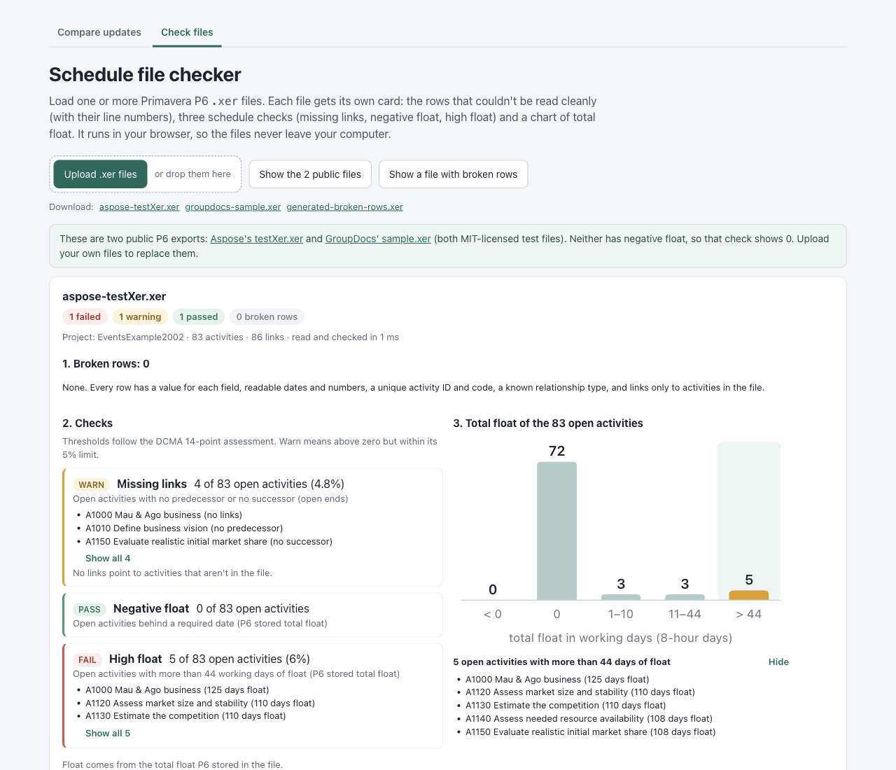
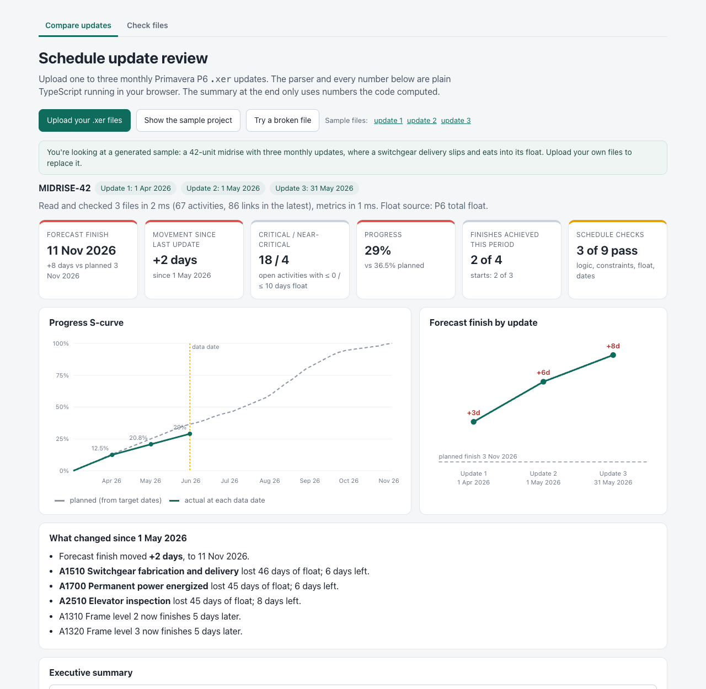

# P6 schedule file checker and update review

**Live demo: https://p6-xer-insights.vercel.app** (file checker: https://p6-xer-insights.vercel.app/#check)

Small working tools for Primavera P6 `.xer` exports, in two tabs that share one parser:

- **Check files**: load any number of `.xer` files (up to 10 at once). Each file gets its own card with the rows that couldn't be read cleanly, three schedule checks and a float chart.
- **Compare updates**: load one to three monthly updates of the same project and see how the forecast finish, float and critical path moved.

The checker builds on the parser and critical-path code from the P6 update-review demo I'd already shared (now the Compare updates tab), which is how it fit in the 2-hour limit. New for the checker: a line number on every row and the broken-row checks, counting links to missing activities in the missing-links check, giving the float checks the same float source as the metrics (before, files without stored float always passed them), the per-file Check files tab with its chart, the sample files, and tests for all of it.



## Check files

Open the **Check files** tab (or go to `/#check`). It loads the two public sample files below. **Show a file with broken rows** loads a generated file that triggers every broken-row reason, and **Upload .xer files** (or dropping files anywhere on the tab) checks your own. Unrelated files are fine here: each one is checked on its own, so none of them is dropped. (The Compare updates tab still skips a file that isn't from the same project, because it compares updates.)

Each card starts with a one-line verdict, for example `1 failed · 1 warning · 1 passed · 0 broken rows`.

### 1. Broken rows

A table of line number, table, activity and reason. A row with more than one problem gets one line listing all of them. The first 10 rows are shown; **Show all** lists the rest (up to 500 on screen).

The Activity column ties each row to something a scheduler recognises:

| Table | Activity column |
|---|---|
| `TASK` | Activity ID and name, for example `B1100 Lighting retrofit` |
| `TASKPRED` | The link as predecessor → successor activity IDs, for example `B1040 → B1170`. An end that isn't in the file reads `999 (not in file)`, a blank one `(blank)` |
| `PROJWBS` | WBS code and name |
| `PROJECT` | Project ID |
| Other tables with a `task_id` | That activity's ID and name |
| An untagged line, or a row too short to have an ID | — |

The checker looks for:

| Reason | What happens to the value |
|---|---|
| Short row: fewer values than the table has fields | Missing values are read as blank |
| More values than fields | The extra values are ignored |
| A line that doesn't start with `%T`, `%F`, `%R` or `%E` (often a value with a line break in it) | The line is skipped |
| A date that can't be read, in any `*_date` field of `PROJECT`, `TASK` or `TASKPRED` (for example `2026-02-30` or `next week`) | Read as blank |
| A duration, float or other hour count in `TASK` that isn't a number (`*_hr_cnt`) | Durations are read as 0, float as blank |
| Blank `task_id` | The row is skipped |
| Duplicate `task_id` | The later row is skipped |
| Blank `task_code`, or the same `task_code` twice in one project | Kept and flagged |
| Unknown `pred_type` (not `PR_FS`, `PR_SS`, `PR_FF` or `PR_SF`, or the bare `FS`, `SS`, `FF`, `SF` some tools write) | Read as finish-to-start |
| A lag that isn't a number | Read as 0 |
| A link to an activity that isn't in the file | The link is ignored and counted in the missing-links check |

### 2. Three checks

All three look at open activities: not complete, and not WBS summaries or level-of-effort activities. The thresholds follow the DCMA 14-point schedule assessment: check 1 (logic: at most 5% of open activities missing a predecessor or successor), check 6 (high float: at most 5% with more than 44 working days) and check 7 (negative float: none). Two things are stricter than DCMA: a count above zero but within the 5% limit shows as a warning rather than a pass, and any link to an activity that isn't in the file fails the missing-links check.

| Check | What it counts | Result |
|---|---|---|
| Missing links | Open activities with no predecessor or no successor. Start milestones don't need a predecessor and finish milestones don't need a successor. Links that point to activities not in the file are counted right next to it. | Pass at 0; warn up to 5% of open activities; fail above 5%, or if any link points to a missing activity |
| Negative float | Open activities with total float below 0 | Fail if there are any |
| High float | Open activities with more than 44 working days (352 hours) of total float | Pass at 0; warn up to 5%; fail above 5% |

Each check shows its count, its share of the open activities and the first three activities (the most negative or highest float first). **Show all** lists the rest.

**Float source.** The float checks use the same float as the update metrics. When at least 90% of the open activities have P6's stored total float (`total_float_hr_cnt`), which is normal for a scheduled export, that is used, and any open activity without it counts as 0. Otherwise the built-in critical-path calculation computes float from durations and links. That calculation uses 8-hour days and ignores calendars and constraints, so computed float is never negative. Each card says which source it used.

### 3. Chart

One bar chart per file: open activities by total float in working days, in the buckets < 0, 0, 1–10, 11–44 and > 44. Part days go in the bucket above (0.5 days counts under 1–10). The < 0 bar always equals the negative-float count and the > 44 bar the high-float count. Clicking a bar (or pressing Enter on it) lists the activities in that range with their float.

### Sample files

| File | Source and license | Broken rows | Missing links | Negative float | High float | Float source |
|---|---|---|---|---|---|---|
| [`aspose-testXer.xer`](public/samples/aspose-testXer.xer) | `testData/testXer.xer` from [Aspose.Tasks Cloud SDK for Python](https://github.com/aspose-tasks-cloud/Aspose.Tasks-Cloud-SDK-for-Python/blob/master/testData/testXer.xer). MIT, Copyright (c) 2020 aspose-tasks-cloud | 0 | 4 of 83 (warn) | 0 of 83 (pass) | 5 of 83 (fail) | P6 |
| [`groupdocs-sample.xer`](public/samples/groupdocs-sample.xer) | `sample.xer` from [GroupDocs.Conversion for .NET](https://github.com/groupdocs-conversion/GroupDocs.Conversion-for-.NET/blob/master/Examples/GroupDocs.Conversion.Examples.CSharp/Resources/SampleFiles/sample.xer). MIT, Copyright (c) 2001-2016 Aspose Pty Ltd | 0 | 70 of 70 (fail: the file has no relationships) | 0 of 70 (pass) | 0 of 70 (pass) | P6 |
| [`generated-broken-rows.xer`](public/samples/generated-broken-rows.xer) | Generated by `brokenRowsSample()` in `src/lib/generate.ts`. Not real project data | 12 | 1 of 14, plus 1 link to a missing activity (fail) | 3 of 14 (fail) | 2 of 14 (fail) | P6 |

Both public files are included unchanged; their full license texts are in [`public/samples/THIRD-PARTY-LICENSES.txt`](public/samples/THIRD-PARTY-LICENSES.txt). Neither has negative float, so 0 is the real result for both. The generated file's float values are made up so those checks have something to flag.

`npm run check -- <files>` prints the same results for any `.xer` files from the command line, with each broken row as `line 26 · TASK · B1100 Lighting retrofit · <reason>` (the first 20 per file).

## Compare updates

Upload one to three monthly updates and it:

- reads the `.xer` file with plain code (no LLM) and rejects broken files with a clear reason, such as a wrong format or circular logic, naming the activities in the loop
- only compares files that are updates of the same project: most activity IDs must match the latest update, the matching activities must have the same names (P6's default A1000, A1010… numbering repeats across projects), and actual start dates already recorded must agree. A different project ID alone only gives a warning, because updates saved as copies often get a new one
- finds the critical and near-critical activities and tracks float between updates
- shows planned vs actual progress (S-curve), the forecast finish at each update, and planned starts and finishes achieved
- runs schedule quality checks: missing links, leads, lags, relationship types, hard constraints, negative and high float, long durations and invalid dates
- writes an executive summary from the computed numbers only, then checks every number and date in it against those numbers



## How it works

| File | What it does |
|---|---|
| `src/lib/xer.ts` | Parses the `%T` / `%F` / `%R` table format, keeps each row's line number, flags short rows and untagged lines; rejects files that aren't P6 exports |
| `src/lib/schedule.ts` | Maps `PROJECT`, `PROJWBS`, `TASK` and `TASKPRED` rows to activities and relationships, flags the other broken-row reasons and ties each broken row to its activity, link or WBS |
| `src/lib/load.ts` | Validates a file, including loop detection, before anything is calculated |
| `src/lib/cpm.ts` | Forward and backward pass with FS, SS, FF and SF links and lags, and the float source rule shared by the checks and the metrics |
| `src/lib/checks.ts` | Schedule quality checks and the float buckets for the chart |
| `src/lib/checkfile.ts` | Checks each file on its own for the Check files tab |
| `src/lib/metrics.ts` | Forecast finish, float, critical path, S-curve, starts and finishes achieved, update-to-update comparison |
| `src/lib/summary.ts` | Summary template, number checker and the prompt contract for an AI-written version |
| `src/lib/generate.ts` | Generates the sample project, the broken-rows file and large test schedules |

## Speed

Measured on a MacBook with Node 24 (`npm run samples`, median of 5 runs):

| Activities | Links | Read and validate | Metrics | Full critical-path calculation |
|---|---|---|---|---|
| 10,000 | 13,681 | 51 ms | 14 ms | 15 ms |
| 50,000 | 68,319 | 241 ms | 70 ms | 69 ms |

The Compare updates tab has buttons that run the same test in the browser.

## Run it

```bash
npm install
npm run dev                  # local app
npm test                     # parser, broken rows, checks, float source, per-file checking, metrics, summary, 10,000-activity test
npm run check -- <files>     # check .xer files from the command line
npm run samples              # regenerate the generated files in public/samples and print timings
```

## Notes

- The midrise sample schedules in the Compare updates tab are generated (a 42-unit midrise with three monthly updates and a switchgear delay), not real project data.
- The built-in critical-path calculation works in 8-hour days and ignores calendars, so it's a cross-check rather than a replacement for P6's scheduler.
- Planned dates come from each activity's target dates.
- When a file holds more than one project, the checks and metrics cover the first project in its `PROJECT` table; broken-row checks cover every row.
- Besides the samples above, it was checked against other public `.xer` files (MPXJ's test exports, among others), including files with a `%E` after every table, files without a PROJECT table, and deliberately corrupt ones.
